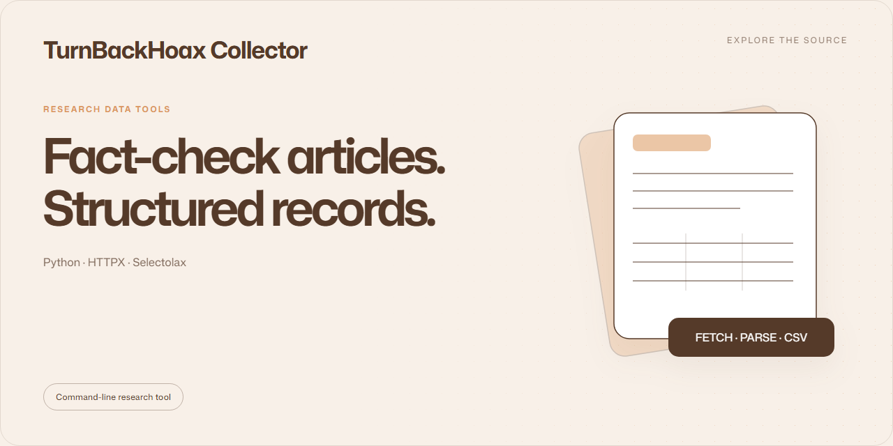

# TurnBackHoax Collector

A Python collector for fact-checking articles, with archive selection, CSV export and historical-URL repair.

**Python · HTTPX · Selectolax** · Command-line research tool

## Tools

| Script | Purpose |
| :-- | :-- |
| [scrape_turnbackhoax.py](scrape_turnbackhoax.py) | Collect article records in automatic or archive mode |
| [repair_turnbackhoax_urls.py](repair_turnbackhoax_urls.py) | Map historical article URLs to repaired URLs |

## Setup

Create and activate a Python virtual environment, then run:

```sh
python -m pip install -r requirements.txt
python scrape_turnbackhoax.py --help
python repair_turnbackhoax_urls.py --help
```

A small collection example:

```sh
python scrape_turnbackhoax.py --mode auto --max 10 --concurrency 1 --out sample.csv
```

Archive mode also accepts a start month and the number of months to inspect.
Use the script's help output for the full option list.

## Responsible use

Review the source site's access rules and content permissions before collecting
or redistributing articles. Keep concurrency modest and use only the amount of
data needed for your research. Included datasets do not grant rights to the
original articles. Crawl state and virtual environments stay local.
See [SECURITY.md](SECURITY.md).
